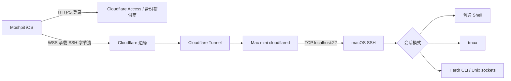

# Moshpit Cloudflare SSH 接入方案

状态：实验实现及真实 Cloudflare 联调进行中；2026-10-27 按用户要求新增 Mac mini 的常驻 SSH 入口。入口部署与客户端 G1/G2 验收分别记录，见 [实施记录](cloudflare-access-implementation.md)，客户端尚未正式发布。设计日期：2026-10-27。
适用范围：当前定制版 Moshpit（iOS）经 Cloudflare 访问 SSH 服务，可选择普通 Shell、tmux 或 Herdr；后续扩展到多用户、多设备。

## 1. 目标与结论

显式选择 Cloudflare 的连接无需手机启用 Tailscale，即可在 Moshpit 原生终端内访问 SSH。保留主机密钥验证、PTY、exec 和文件传输；tmux、Herdr 是可选会话模式，不是连接或认证的前提。
第一阶段复用 SSH，在底层增加 Cloudflare 传输，不重写 Herdr 或终端协议。

核心问题是手机依赖外部 Tailscale VPN 状态：掉线后用户必须离开 Moshpit 手动重连。目标体验是打开 Moshpit 即可访问自己的电脑，由 App 管理连接检测、重连以及所选会话模式的恢复；仅在认证过期或需要用户决策时提示。

连接方式按每条服务配置明确选择，不全局切换默认入口。普通连接沿用现有直连/SOCKS 流程，包含公网、局域网地址、普通域名以及 Tailscale IP/MagicDNS。只有用户显式选择 Cloudflare 的连接才进入 Access 登录和隧道流程；这类连接不依赖手机启用 Tailscale。本方案不涉及 Magpie API 或其 Key。

Cloudflare Tunnel 是网络中继，Cloudflare Access 是入口身份校验，SSH 是主机身份与操作授权；Shell、tmux、Herdr 属于可选的会话层。传输层不依赖具体会话模式。

“普通 SSH 客户端把 IP 换成域名即可连接”不成立。Cloudflare 的公开 SSH Tunnel 需要客户端适配；官方常规方式是客户端运行 cloudflared。iOS 自定义实现的协议兼容性与 Access 登录凭据获取必须先做验证。

本方案不承诺 iOS 后台维持长连接，也不承诺隧道重连后续传旧 SSH 字节流。恢复目标是重新建立 SSH，并按所选模式处理会话；只有持久会话仍存在时才能重新附着，普通 Shell 不保证断线后存活。

## 2. 当前工程与部署基线

以下来自本地源码及运行状态检查，不代表其他安装环境：

| 位置 | 已有能力 | 接入意义 |
| --- | --- | --- |
| `Moshpit/Services/SSHService.swift` | `SSHClientProvider.connect(on: Channel, ...)`；直连与 SOCKS 分支；统一凭据及 TOFU 校验 | 新增隧道拨号分支，继续使用 Citadel SSH |
| `Moshpit/Services/SOCKSProxyDialer.swift` | 返回握手完成后的 NIO Channel | 可借鉴拨号、超时、关闭纪律；不直接复用 SOCKS 协议 |
| `Moshpit/Models/ServerConnection.swift` | Codable 连接模型、可选 SOCKS 字段、SSH/Herdr 设置 | 新字段必须兼容旧存储 |
| `Moshpit/Services/Herdr/HerdrSocketClient.swift` | 与传输无关的 JSON 字节管道；断连不支持事件重放 | 保留协议解析，恢复时重新 snapshot/subscribe |
| `Moshpit/Services/Herdr/HerdrFrameChannel.swift` | Herdr 终端帧及控制 | 保留终端渲染和重新附着语义 |
| `Moshpit/Services/SessionHub.swift` | 会话生命周期、重连及 sidecar 管理 | 新传输必须覆盖主连接、控制连接和附属连接 |
| `Moshpit/Services/HostKeyValidator.swift` | SSH 主机密钥信任 | 不因使用 HTTPS 而跳过 |
| `Moshpit/Services/KeychainService.swift` | 凭据存储 | Access 凭据另设命名空间 |
| `Moshpit/UI/Home/AddConnectionView.swift` | 连接编辑 | 增加 Cloudflare 入口配置及登录状态 |

Mac mini 当前运行 Herdr 0.9.5，JSON socket 为 `~/.config/herdr/herdr.sock`；没有发现 Herdr 自身监听 HTTP 端口。
现有 `ai.aias.eu.org` Tunnel 用于 Magpie，不应混用其 API 路径与管理凭据。
现有 Tailscale 连接保留为显式可选入口和验收对照，不自动替用户切换。新建 Cloudflare 连接不得依赖 Tailscale IP 做健康检查、发现主机或建立附属通道；已有连接不被自动迁移。

相关已有设计：

- [总体架构](../ARCHITECTURE.md)
- [Herdr 集成](herdr-multiplexer.md)
- [可漫游传输](roaming-transport.md)
- [薄桥设计](bridge-daemon-spec.md)

本文解决访问入口，不替代可漫游传输方案；WSS 上的 SSH 仍是断线后重建。

## 3. 推荐架构



Mac mini 主动建立出站 Tunnel，不开放公网 SSH 入站。手机仅需要常规 HTTPS/WSS 网络。
WSS 在 Cloudflare 终止，但内层 SSH 仍校验主机密钥并加密终端载荷；Access 身份、连接元数据与 SSH 内容的可见性应分开说明。

为 SSH 接入使用独立 Tunnel。`terminal.aias.eu.org` 已于 2026-10-27 按用户要求部署为 Mac mini 的常驻入口，客户端仍不内置此域名。每条连接由用户主动配置入口域名、Access 团队域名和应用 Audience；允许登录的邮箱或身份组由用户自己的 Access 策略管理。独立 Tunnel 便于更新、停用及回滚，不影响 Magpie。

### 3.1 连接方式与会话模式正交

连接方式决定如何取得 SSH 字节流：直连、SOCKS 或 Cloudflare。会话模式决定 SSH 建立后运行什么：普通 Shell、tmux 或 Herdr。
复用 `ServerConnection.multiplexer` 的既有语义，不因选择 Cloudflare 自动设置为 Herdr，不因切换会话模式改动连接方式。
Cloudflare + Shell 的拨号、认证、健康检查不得执行 Herdr 探测或创建 Herdr sidecar。只有相应模式才检查其依赖；未安装 Herdr 不影响 Shell/tmux。

| 连接方式 | 普通 Shell | tmux | Herdr |
| --- | --- | --- | --- |
| 直连（含 Tailscale 地址） | 保留原流程 | 保留原流程 | 保留原流程 |
| SOCKS | 保留原流程 | 保留原流程 | 保留原流程 |
| 显式 Cloudflare | 新隧道 + 既有 Shell | 新隧道 + 既有 tmux | 新隧道 + 既有 Herdr |

## 4. 技术关口：先验证再实施

### G1：原生 WSS 与 Cloudflare SSH Tunnel 互通

固定一个用于实验的 cloudflared 版本，检查其官方源代码及许可，记录 commit、升级请求路径、必要 headers、字节封装、关闭与错误行为。
用官方桌面 cloudflared 客户端作为对照，制作最小 Swift/NIO 客户端，验证 SSH banner、密钥交换、双向 exec 和大流量。
不得假设“任意路径建立 WebSocket 即可”，也不得把内部协议当稳定的公开移动 SDK。

通过条件：Swift 客户端通过同一 Access 保护入口获得原始 SSH 字节流，并完成真实 SSH 握手与主机密钥校验。

### G2：Access 登录到原生 App 的凭据交接

浏览器登录成功不代表 URLSession/NIO 自动得到浏览器 Cookie。先验证所选 Access 登录机制能否安全交付原生客户端可用的凭据。
优先研究并复用官方 cloudflared 的登录交接机制；若有可用回调机制，采用 ASWebAuthenticationSession、绑定 state、验证回调与目标域名。具体交换端点、令牌格式和刷新方式由实验记录确定，不预先虚构 OAuth 接口。
令牌仅存 Keychain，绑定账户、入口与 Access 应用 audience；不记录 Cookie 或 Authorization。
用户取消登录不触发无限重试。过期优先采用经过验证的刷新机制，否则提示重新登录。

通过条件：首次登录、App 重启后复用、令牌过期、撤销授权均可复现且无手工复制 Cookie。
禁止在所有 App 内置共享的 Cloudflare Service Token、Tunnel Token 或管理 API Token。

### G1/G2 不通过时的替代

使用自有薄桥：Cloudflare 发布普通 HTTP/WSS 服务，由桥将认证后的 WSS 字节流转发到固定本地 SSH 地址。
这样需要开发少量主机端代码，但 WSS 应用协议由我们控制。桥仍需可靠的原生登录/短期票据机制，不能用“换成普通 WSS”来绕开认证问题。
如果 Access 原生登录无法落地，可由业务后端登录并签发一次性短期设备票据，桥验证后升级连接；Cloudflare 负责 TLS/Tunnel，桥负责业务认证。
桥只允许固定 SSH 上游，禁止客户端指定任意 IP/端口。一次性票据绑定目标设备、有效期、nonce，原子消费；不经 URL 查询参数传递长期秘密。
主路线与替代路线在 G1/G2 结束后选择其一，避免维护两套未完成协议。

## 5. iOS 改动设计

### 5.1 连接模型与迁移

新增可选 `transportRaw`（`direct`、`socks5`、`cloudflareSSH`）、`cloudflareHostname` 和 Access 应用标识配置；最终字段命名随代码评审确定。
旧记录缺字段时，按现有 SOCKS 开关推导原行为。未知传输值必须报告不支持，不能悄悄直连。
迁移后统一解析成单一有效传输配置，避免新枚举与旧 `useSOCKSProxy` 同时生效。
第一版不叠加 SOCKS 与 Cloudflare；UI 说明它们互斥。

区分三个身份：外部 WSS 域名、SSH 逻辑主机、可信主机密钥。保留既有 host/port 的信任含义；外部域名不自动成为 SSH 信任键。
允许用户明确关联现有连接，继续校验已信任的 Mac mini 主机密钥，不靠相同显示名称自动关联。

### 5.1.1 按连接类型分流

| 服务地址与配置 | 使用流程 |
| --- | --- |
| 普通公网 IP、局域网 IP 或域名 | 现有 SSH 直连流程；不触发 Access |
| 普通连接启用 SOCKS | 现有 SOCKS + SSH 流程；不触发 Access |
| 普通连接使用 Tailscale IP / MagicDNS | 现有 SSH 流程，由系统 Tailscale 网络路由；不触发 Access |
| 明确标识为 Cloudflare 的连接 | Access 按需登录 → WSS 隧道 → SSH → 所选会话模式 |

传输类型是显式持久化的配置，不根据域名后缀、DNS 结果、Tailscale 开关或拨号失败猜测。普通域名即使托管在 Cloudflare，也不自动进入 Cloudflare SSH 流程。
手机启用 Tailscale 时，普通 Tailscale 地址仍可照常使用；关闭后不可达则按既有失败和重连处理，不自动改走 Cloudflare。
Cloudflare 类型即使手机开启 Tailscale，也保持 Cloudflare 流程；底层系统路由不由 App 强制绕过 VPN。
连接失败不自动跨类型回退。同一主机可分别保存普通连接和 Cloudflare 连接；主机信任关联仍需显式确认。
验收必须覆盖上述四类路径，证明普通连接不触发 Access，Tailscale 启停不改变连接类型，旧配置无须修改。

### 5.2 新组件与接口边界

| 拟新增组件 | 责任 |
| --- | --- |
| `CloudflareAccessAuth` | 登录、凭据隔离、过期处理；并发登录合并 |
| `CloudflareSSHDialer` | TLS、升级、超时、取消，返回 SSH 可用 Channel |
| `WebSocketByteStreamHandler` | WS 帧与连续 ByteBuffer 互转、流控、关闭传播 |
| 连接诊断模型 | 登录/边缘/隧道/SSH/可选会话层分层错误 |

实验版已新增这些组件，当前实现与验收范围见 [实施记录](cloudflare-access-implementation.md)。
复用 `SSHClientProvider.connect(on:)`，确保 SSH exec、PTY、文件传输、能力探测和 sidecar 使用相同的拨号入口。
实现前全工程搜索直接调用 `SSHClient.connect` 和独立 host:port 拨号，防止主终端能通而附件或控制面走旧 Tailscale 地址。

NIO Channel pipeline 必须让 Citadel 看到原始有序字节，而非 WebSocket 帧。正确处理分片、ping/pong、close、空帧、SSH 初始 banner 与升级完成时已到达的数据。
优先采用现有 NIO 技术栈实现，降低 URLSession 与 NIO 跨执行器桥接的复杂度。TLS 验证系统信任和域名，不接受无条件忽略证书。

建议初始参数（待实验调整）：拨号/升级 15 秒，前台空闲时 20 秒心跳、10 秒 pong 超时，单连接发送队列高水位 1 MiB/低水位 256 KiB。
必须实现背压与限额，超过阈值暂停上游读取或明确断开，不无限堆内存；禁止为了恢复而丢弃 SSH 密文字节。

### 5.3 UI 与错误

连接表单增加“直连 / SOCKS / Cloudflare”选择，默认保持普通直连。显式选择 Cloudflare 后默认沿用 Host 域名，展示登录按钮、账户状态和测试连接；点击登录时自动读取并验证 Access 配置。入口覆盖、团队域名和 AUD 的手动设置放入高级配置，已有记录保持原有直连/SOCKS 行为及已保存的手动参数。
保留 SSH 用户及密钥设置；Access 登录不会自动赋予 macOS 登录权限。
连接过程展示“登录 → 连接入口 → SSH 验证 → 打开或恢复所选会话”，避免把 302 登录页、403 拒绝和 SSH 密码错误合成“网络异常”。
有效凭据下无需每次登录；临时断网自动显示“正在重新连接”，不要求用户打开 Tailscale。认证失效进入单一登录提示；主机长期离线提供重试或取消，不反复弹窗。连接方式切换由用户明确触发，不静默降级到 Tailscale。
区分 DNS/TLS、Access 需登录、Access 拒绝、WSS 升级失败、Tunnel 离线、SSH 握手、主机密钥变化、Herdr 不兼容。
不把 HTML 登录响应交给 SSH 解码，不将 Access 403 当密码错误，不对永久拒绝无限重试。

### 5.4 Mosh 与其他能力

此路线只承载 SSH/TCP；不能据此声称已有 UDP Mosh 支持。
选择 Cloudflare SSH 时禁用 Mosh UDP 模式并说明原因；第一版支持普通 SSH Shell，并分别接入既有 tmux、Herdr 模式；不得要求安装 Herdr 才能使用 Cloudflare。
附件/SFTP、终端 resize、控制命令、能力探测与推送注册分别验收，不假设只改 PTY 就覆盖所有路径。

## 6. 生命周期与恢复

```text
idle → authenticating → dialing → upgrading → sshHandshake
     → openingOrAttachingSelectedSession → active
active → disconnected → backoff → dialing
需登录 → waitingForUser；拒绝授权/主机密钥变化 → stopped
```

SessionHub 保持唯一重连所有者，拨号器只负责单次连接。使用连接代次或 cancellation token，防止旧回调覆盖新会话。
退避建议 1/2/4/8/15/30 秒上限并加随机抖动；成功稳定一段时间后重置。用户主动断开立即取消。
锁屏、后台挂起、Wi-Fi/蜂窝切换均按连接可能失效处理；回前台重新确认连接，不申请无实际用途的后台模式。

通用恢复顺序：清理旧连接及已启用的 sidecar → 按需登录 → 新隧道/SSH → 按连接记录选择会话模式。

| 模式 | 重连行为 | 不应承诺的能力 |
| --- | --- | --- |
| 普通 Shell | 重新打开 PTY/Shell，明确提示旧终端已断开及是否建立新 Shell | 原 PTY、原进程和输出自动续传；进程可能退出，也可能仍运行，不能假设其状态 |
| tmux | 按既有会话标识重新附着，同步终端尺寸和控制状态 | 会话已被删除后仍能恢复；自动重放未确认命令 |
| Herdr | 重新拉 snapshot、订阅事件、重新附着终端并同步尺寸 | 事件按序重放，或远端会话已退出后仍能恢复 |

Herdr 事件流无可重放序号，恢复期间以 snapshot 校正；终端全量帧到达后再替换冻结画面。此规则仅适用于 Herdr 模式，不成为通用拨号器的依赖。
不自动重放终端按键、exec、附件上传或其他可能有副作用的未确认操作；提示用户其结果可能未知。
tmux/Herdr 会话仍存在时不重建 shell、不重复启动 agent；会话已退出时明确展示失败和新建入口，不静默新建并声称恢复成功。

## 7. Mac mini 与 Cloudflare 部署

配置示例只供实施使用，本文不执行命令、不包含真实凭据：

```yaml
# 独立 tunnel 的示意配置；替换占位符
tunnel: <HERDR_TUNNEL_ID>
credentials-file: <CREDENTIALS_FILE>
ingress:
  - hostname: terminal.aias.eu.org
    service: ssh://127.0.0.1:22
  - service: http_status:404
```

实施时按实际 cloudflared 版本校验配置。
部署顺序：

1. 确认本地 SSH 已开启、仅允许预期用户；先验证普通 Shell。仅在选择 tmux/Herdr 时检查对应安装与会话。
2. 新建 Access 应用与最小允许策略，其他身份拒绝；再发布 Tunnel/DNS，避免短暂裸露。
3. 建立独立 Tunnel、DNS 路由和 launchd 服务；凭据文件仅服务用户可读。
4. 官方桌面客户端先验证 Access 登录、SSH 主机指纹、exec 和普通 Shell，再按需验证 tmux/Herdr。
5. iOS 实验版验证后再让用户保存 Cloudflare 连接。
6. 保留现有 Tailscale 配置；回滚只停用新的连接方式/Tunnel，不修改 Magpie。

首次连接不能仅依据新域名自动接受 SSH 指纹。应与本机已知指纹或既有可信连接核对。
Access 会话过期/策略变更不应假设立即终止已建立 SSH；立即撤销需求需确认平台行为，并具备断开隧道或服务器会话的运维手段。

## 8. 普通用户产品化边界

个人接入阶段可以手工配置自己的 Cloudflare 租户。普通用户版本不能要求每位用户创建 Tunnel 和填写 Access audience。
产品化需要独立控制面：账号登录、设备注册、每设备凭据、权限、设备在线状态、吊销、域名/入口分配和审计。
Cloudflare 管理 API 凭据只在后端；设备只得到自己的 Tunnel/接入凭据，手机只得到自己获授权的连接信息。
SSH 凭据仍是第二道认证；“只登录一次”需要另外设计设备配对和密钥下发/授权，不能静默移除 SSH 校验。

规模化时在“托管 Cloudflare 数据面”与“自有 frp/WSS 中继”之间按实际地区连通性、成本、服务条款、限额和运维能力选择。本文不保证任何免费套餐适合大规模商业转发。
自有账号体系与设备身份应独立于 Cloudflare，避免用户数据库绑定隧道供应商。

## 9. 观测与故障定位

记录脱敏 connection ID、连接代次、各阶段耗时、关闭码、重连原因、队列峰值和恢复耗时；不记录私钥、Access Token、Cookie、终端内容或附件载荷。
分开统计到边缘 RTT、SSH 建立耗时、所选模式的终端首帧耗时；HTTP 握手成功不等于业务成功。
主机端监控 cloudflared 存活、连接数、SSH 可达、已启用的 tmux/Herdr 存活、CPU/内存和出口网络。
Tunnel 多连接可改善连接器可用性，但单台 Mac mini 仍是故障点；副本不能把同一有状态终端迁移到另一台主机。

## 10. 分阶段交付

| 阶段 | 交付物 | 完成标准 |
| --- | --- | --- |
| P0 兼容性验证 | 固定版本的协议笔记、Swift 最小实验、登录交接实验 | G1/G2 均通过，或明确选择薄桥替代 |
| P1 传输接入 | Codable 迁移、拨号器、登录、分层错误、连接 UI | 不启用 Tailscale 仍能完成 SSH exec/PTY；直连/SOCKS 不回归 |
| P2 会话模式与恢复 | 普通 Shell、tmux、Herdr 分别接入；附属连接统一拨号 | Shell 明确重建边界；tmux/Herdr 恢复存续会话，不重复执行输入 |
| P3 部署与灰度 | 独立 Tunnel、Access、诊断页、运维与回滚说明 | 蜂窝与异地 Wi-Fi 实测；具备可定位的错误与回滚 |
| P4 产品控制面 | 账号、设备配对、撤销、自动配置 | 新用户不用 Cloudflare 控制台即可完成绑定 |

P0 是必须的决策关口，不在协议和登录未验证时排定完整实现工期。
首个真机里程碑是：远端不安装 Herdr，手机关闭 Tailscale → Moshpit 内登录 → 完成 SSH exec 和普通 Shell。随后分别验收普通 Shell 的断线重建提示、tmux/Herdr 的存续会话恢复，全程无需操作外部 VPN。P0 验证失败时转向薄桥路线，不把安装 Tailscale 作为最终解决办法。

## 11. 验证矩阵

- 模型：旧连接 JSON 解码、缺字段、未知枚举、互斥字段冲突、主机身份关联。
- 认证：首次登录、取消、并发登录、重启复用、过期、错误 audience、设备撤销；日志无凭据。
- 传输：101 成功、302/401/403、TLS 错误、无 SSH 上游、WS 分片、二进制随机字节往返、背压、取消和 close 只完成一次。
- SSH：未知/变化指纹、错误密钥、exec、PTY、resize、SFTP/附件、多个通道和 sidecar。
- 普通 Shell：远端未安装 Herdr 时仍可连接、PTY 输入输出、resize、exec 和附件；断线后明确重建边界，不执行 Herdr 命令。
- tmux：选择既有会话、控制连接与终端恢复；缺少 tmux 只影响该模式。
- Herdr：snapshot + subscribe、会话列表、终端帧、输入、滚动、尺寸、恢复已有会话；缺少 Herdr 只影响该模式。
- 生命周期：锁屏 1/5/30 分钟、Wi-Fi→蜂窝、断网重连、Tunnel 重启、边缘断开、Mac mini 休眠、账号拒绝。
- 独立性：手机 Tailscale 完全断开或未安装时，首次连接、附件、控制面、重连均正常；Mac mini 的 Tunnel 上游使用 localhost，不依赖其 Tailscale 地址。
- 网络：手机关闭 Tailscale，分别用蜂窝和异地 Wi-Fi；记录 20 次拨号成功率、P50/P95 建连与首帧耗时；连续运行至少 2 小时并执行空闲与大输出测试。
- 回归：直连、Tailscale IP、SOCKS、既有 Herdr 连接；不修改已有连接配置即可继续使用。

性能验收目标：正常网络 20 次拨号全部成功、无重复命令和无界内存增长；所有网络失败有超时与可读错误。延迟不承诺优于当前约 25 ms 的 Tailscale IPv6 直连，实测后再设地区化指标。
交付时记录设备/系统/App/cloudflared/Herdr 版本和测试网络。模拟器测试不能替代真机后台与换网验证。

## 12. 官方参考与待确认项

- [Cloudflare 客户端 cloudflared SSH 接入](https://developers.cloudflare.com/cloudflare-one/networks/connectors/cloudflare-tunnel/use-cases/ssh/ssh-cloudflared-authentication/)
- [Cloudflare WebSocket 支持、连接终止与心跳](https://developers.cloudflare.com/network/websockets/)
- [Cloudflare Tunnel 路由](https://developers.cloudflare.com/tunnel/concepts/routing/)
- [浏览器 SSH（独立备选，不是原生 Moshpit 传输）](https://developers.cloudflare.com/cloudflare-one/networks/connectors/cloudflare-tunnel/use-cases/ssh/ssh-browser-rendering/)

待 P0 明确：所选版本的原生 WSS 封装、Access 原生登录与刷新机制、iOS 登录交接可行性、实际配额及目标网络可用性。
当前已实现可自行配置的实验客户端，并记录固定版本的协议行为；另建了隔离测试入口及用户要求的 Mac mini 常驻 SSH 入口。现有 SSH 服务及其他应用的 Access 策略未改动。真实租户登录、蜂窝网络及真机生命周期验证仍是启用正式客户端支持前的关口。
